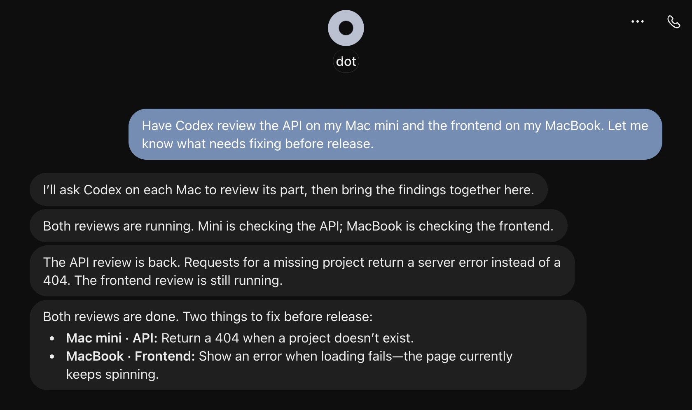
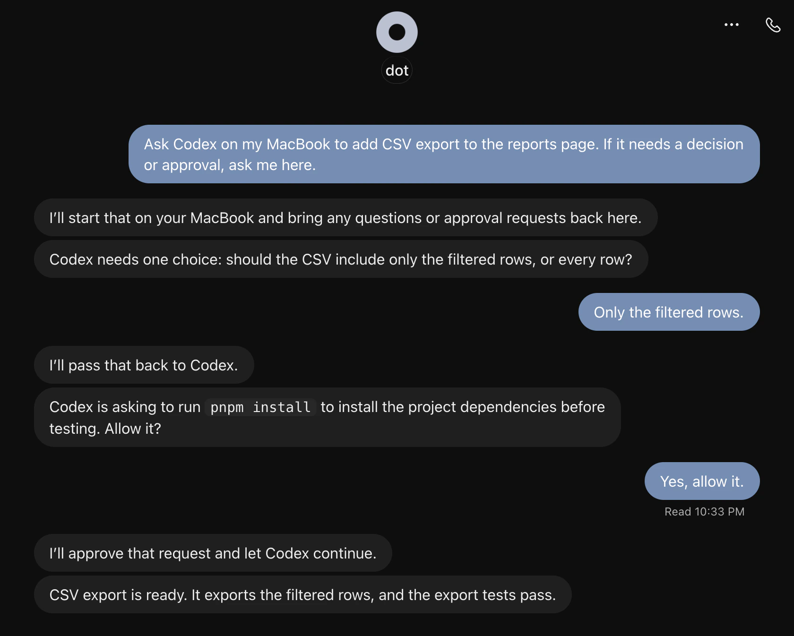

<p align="center">
  
</p>

<h1 align="center">DotX</h1>

<p align="center">
  <a href="https://github.com/Vizards/DotX/releases/latest">
    
  </a>
  <a href="https://github.com/Vizards/DotX/releases/latest">
    
  </a>
</p>

DotX connects your Personal Agent to native Codex on your Macs. Start new tasks, continue existing conversations, handle approval requests, and bring results back to your conversation.


## Get started

Copy the message for your goal. The Agent follows the [Agent guides](docs/index.md) and asks for any missing details, such as your existing Server URL.

### Install for the first time

Send to any Agent. Codex Desktop is recommended.

```text
Help me install DotX: https://github.com/Vizards/DotX
```

### Connect another Personal Agent

Send to the Personal Agent you want to add.

```text
Connect yourself to my existing DotX network: https://github.com/Vizards/DotX
```

### Connect another Mac's Codex

Send to Codex on that Mac.

```text
Connect this Mac's Codex to my existing DotX network: https://github.com/Vizards/DotX
```

## What you can do

Any Personal Agent with MCP support is welcome to try DotX. Start with the [Personal Agent guide](docs/personal-agents/index.md), with ready-to-use recipes for [dot](docs/personal-agents/dot/index.md) and [Cue](docs/personal-agents/cue/index.md). Connected a new client? We welcome a PR sharing the steps that worked for you.

### Start tasks and continue conversations

Your Personal Agent can create a new Codex conversation directly or send follow-up work to an existing one. Codex uses the projects, files, and tools on that Mac.


### Work across your Macs

Your Personal Agent can coordinate Codex tasks on several Macs at once and bring their progress and results into one conversation.



### Answer Codex from the same chat

When Codex needs a decision, your Personal Agent can bring the question or approval request back to you and pass your answer along. Ask to be notified when the task finishes, or check its progress whenever you need to.



### Let your Personal Agent handle updates

Your Personal Agent can spot new releases as you use DotX and let you know when an update is available. When you're ready, you can ask it to coordinate updates across your Macs and the Cloudflare service.

## Help

See [Troubleshooting](docs/troubleshooting/index.md) for known issues, or [report a problem](https://github.com/Vizards/DotX/issues).

## License

[MIT](LICENSE)
