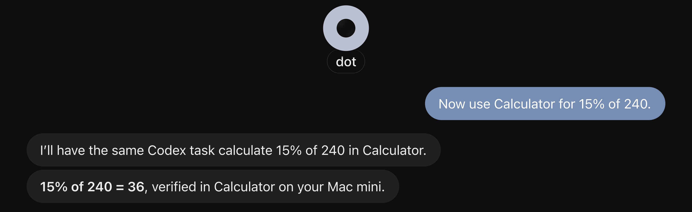
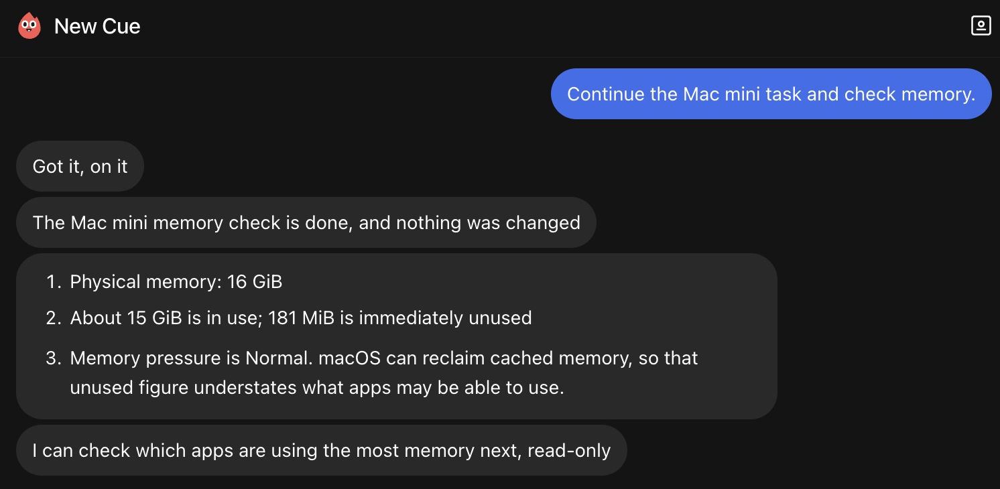
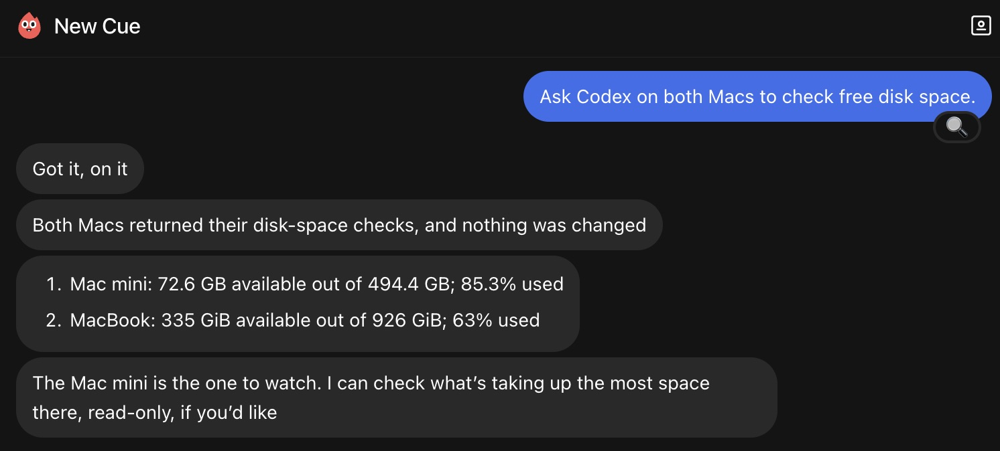
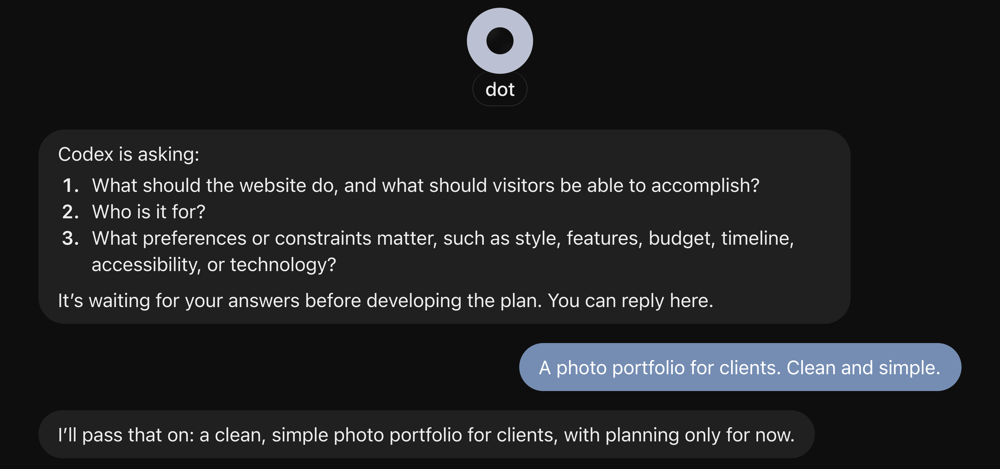
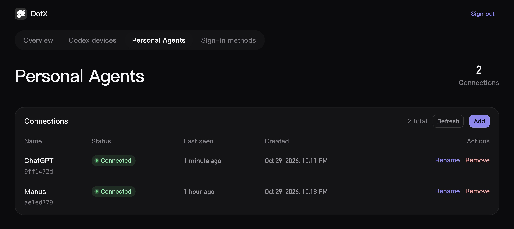

<p align="center">
  
</p>

<h1 align="center">DotX</h1>

<p align="center">Let any personal agent use your Codex — including computer use.</p>

<p align="center">
  <a href="https://github.com/Vizards/DotX/releases/latest">
    
  </a>
  <a href="https://github.com/Vizards/DotX/releases/latest">
    
  </a>
</p>


Connect your MCP-compatible agent to Codex on your Macs. Start tasks, continue conversations, and let Codex work with your local files, apps, and browser.

## Get started

Copy the message for your goal. The Agent follows the [Agent guides](docs/index.md) and asks for any missing details, such as your existing Server URL.

### Install for the first time

Send to any Agent. Codex Desktop is recommended.

```text
Help me install DotX: https://github.com/Vizards/DotX
```

### Connect another Personal Agent

Send to the Personal Agent you want to add.

```text
Connect yourself to my DotX: https://github.com/Vizards/DotX
```

### Connect another Mac's Codex

Send to Codex on that Mac.

```text
Connect this Mac's Codex to my DotX: https://github.com/Vizards/DotX
```

## What you can do

DotX exposes Codex's native App Server and App Tools through MCP, so your Personal Agent can operate Codex directly on your Macs, using its native conversations, tools, and capabilities.

### Work with apps and browsers on your Mac

Ask your Personal Agent to have Codex work with local apps, browsers, and files. With computer use enabled in Codex, it can check a page, interact with an app, and bring the results back to your conversation.



### Pick up where you left off

Continue a Codex conversation already running on your Mac, check its progress, or send it the next task. Your Personal Agent can also start a new conversation in the right project.



### Work across your Macs

Your Personal Agent can coordinate Codex tasks on several Macs at once and bring their progress and results into one conversation.



### Keep the conversation in one place

When Codex needs a decision, your Personal Agent can bring the question or approval request back to you and pass your answer along. Ask to be notified when the task finishes, or check its progress whenever you need to.



### Stay in control

Manage your Personal Agents and Codex devices from a web dashboard hosted in your own Cloudflare account. Review connection requests and revoke access whenever you need to.



## Help

See [Troubleshooting](docs/troubleshooting/index.md) for known issues, or [report a problem](https://github.com/Vizards/DotX/issues).

## License

[MIT](LICENSE)
