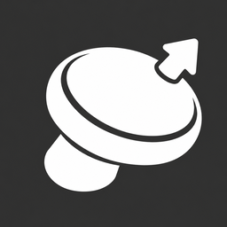
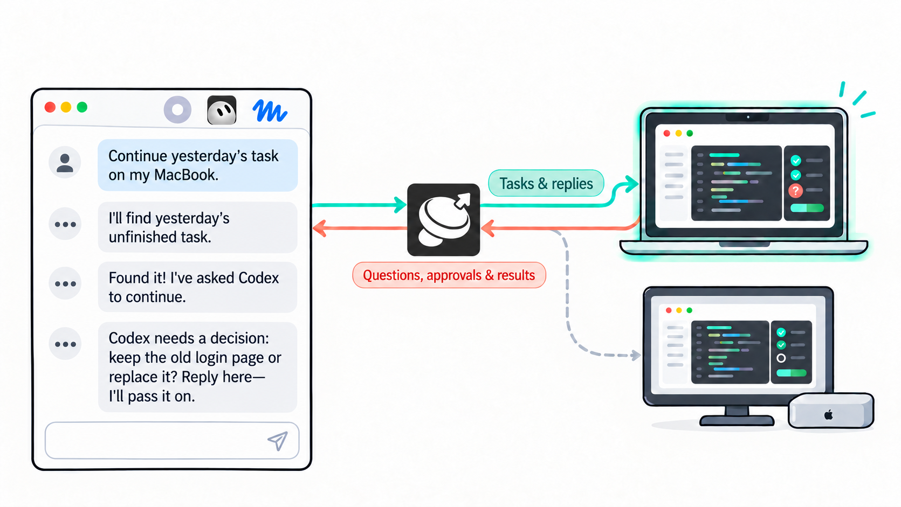
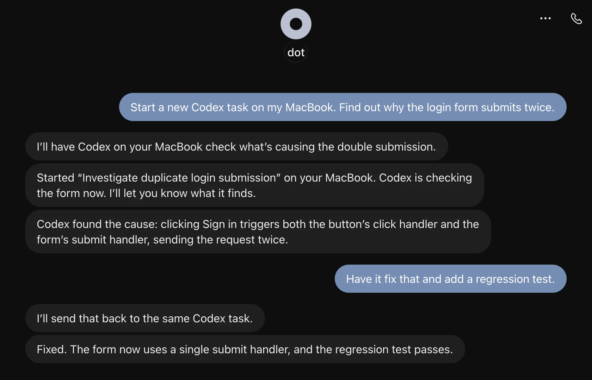

<p align="center">
  
</p>

<h1 align="center">DotX</h1>

<p align="center">
  <a href="https://github.com/Vizards/DotX/releases/latest">
    
  </a>
  <a href="https://github.com/Vizards/DotX/releases/latest">
    
  </a>
</p>

DotX connects your Personal Agent to native Codex on your Macs. Start new tasks, continue existing conversations, handle approval requests, and bring results back to your conversation.



## Get Started

Open Codex on your Mac and send:

```text
Install DotX on this Mac: https://github.com/Vizards/DotX. Follow INSTALL.md.
```

We recommend enabling computer use in Codex. It can follow the [setup instructions](INSTALL.md) to set up Cloudflare Workers, install DotX, and connect ChatGPT or dot, asking you to sign in or grant access when needed.

## What you can do

In principle, any Personal Agent that supports MCP can connect to DotX. The setup skill will try to configure the ChatGPT plugin for you, making DotX available in dot, Chat, and Work. If you run into compatibility issues, feel free to [open an issue](https://github.com/Vizards/DotX/issues).

### Start tasks and continue conversations

Your Personal Agent can create a new Codex conversation directly or send follow-up work to an existing one. Codex uses the projects, files, and tools on that Mac.



### Work across your Macs

Your Personal Agent can coordinate Codex tasks on several Macs at once and bring their progress and results into one conversation.


### Answer Codex from the same chat

When Codex needs a decision, your Personal Agent can bring the question or approval request back to you and pass your answer along. Ask to be notified when the task finishes, or check its progress whenever you need to.


### Add another Mac

All your Macs can share the same DotX service. On a new Mac, tell Codex:

```text
Connect this Mac to my existing DotX: https://github.com/Vizards/DotX. Follow INSTALL.md.
```

Codex handles local setup and guides you through approving the new Mac.

### Let your Personal Agent handle updates

Your Personal Agent can spot new releases as you use DotX and let you know when an update is available. When you're ready, you can ask it to coordinate updates across your Macs and the Cloudflare service.

## Help

See [Troubleshooting](docs/troubleshooting/index.md) for known issues, or [report a problem](https://github.com/Vizards/DotX/issues).

## License

[MIT](LICENSE)
