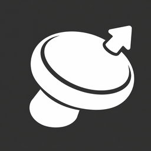
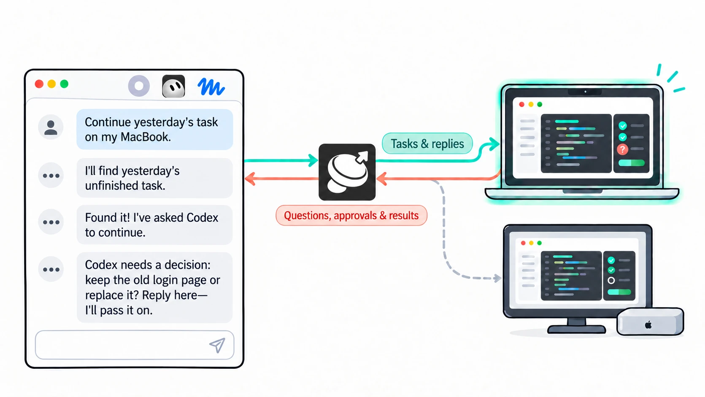
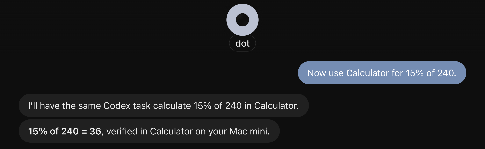
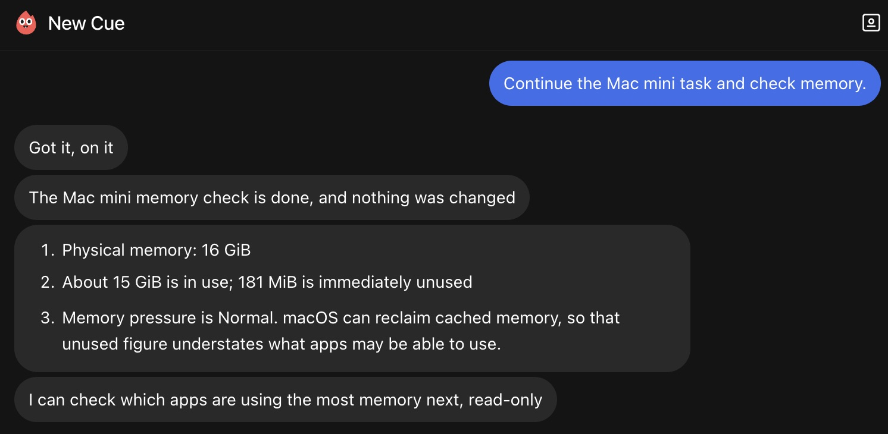
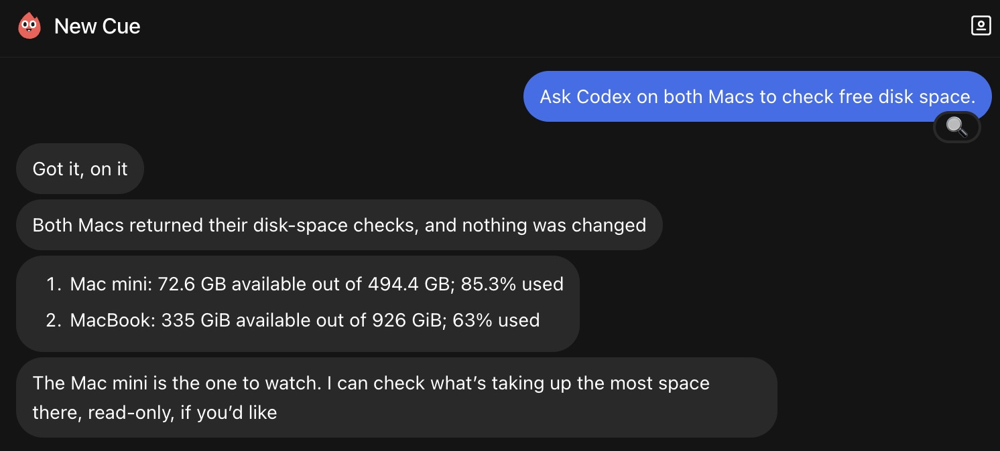
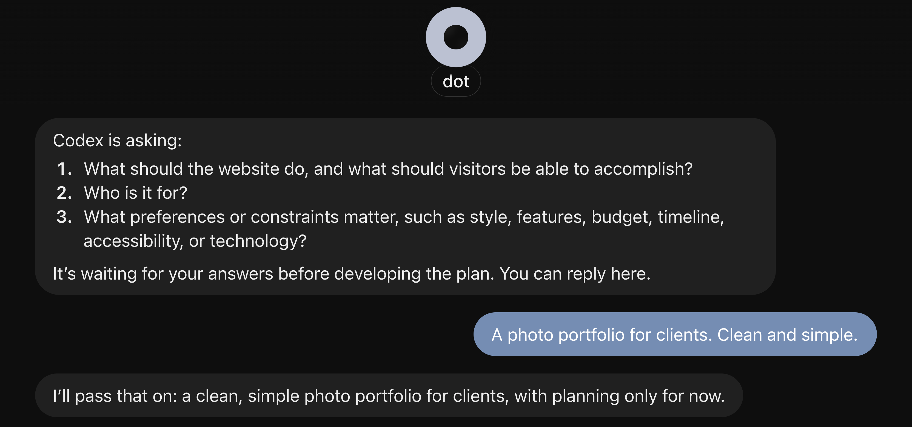
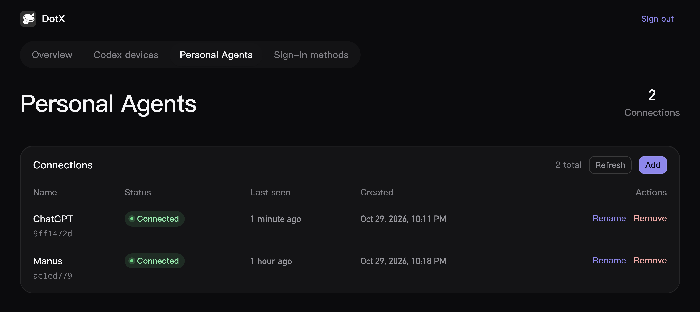

<p align="center">
  
</p>

<h1 align="center">DotX</h1>

<p align="center">让你的任意 Personal Agent 跨设备操控 Codex（包括 Computer Use）</p>

<p align="center">
  <a href="https://github.com/Vizards/DotX/releases/latest">
    
  </a>
  <a href="https://github.com/Vizards/DotX/releases/latest">
    
  </a>
</p>

<p align="center">
  <a href="README.md">English</a> |
  简体中文
</p>



将支持 MCP 的 Personal Agents 连接到你各台电脑上的 Codex。随时发起任务、无缝接续对话，通过 Codex 直接操作任意电脑上的文件、应用和浏览器。

- **任意 Personal Agent：** 不仅支持 dot，你手头现有的 Personal Agent 都能直接接入
- **设备全互通：** 电脑想连几台就连几台，经授权的 Agent 可以随时调用其中任意一台
- **多 Agent 协同：** 支持同时授权多个 Personal Agent，每个都能操控你网络中的任意 Codex

## 开始使用

根据你的需求复制下方对应的指令。Agent 会自动参考 [Agent 指南](docs/index.md) 完成配置，并向你询问缺失的信息（例如已有的 Server URL）。

### 首次安装

发送给任意 Agent 即可（推荐使用 Codex Desktop）：

```text
帮我安装 DotX：https://github.com/Vizards/DotX
```

### 接入新的 Personal Agent

发送给你想要添加的那个 Personal Agent：

```text
把你自己接入我的 DotX：https://github.com/Vizards/DotX
```

### 接入其他电脑上的 Codex

发送给目标电脑上的 Codex：

```text
把这台电脑的 Codex 接入我的 DotX：https://github.com/Vizards/DotX
```

## 核心功能

DotX 通过 MCP 协议将 Codex 原生的 App Server 和 App Tools 暴露出来。你的 Personal Agent 将能直接调用 Codex 的原生对话、工具与各项能力，在你的电脑上全权操控 Codex。

### 操控本地应用与浏览器

直接让你的 Personal Agent 指挥 Codex 处理本地应用、浏览器和文件。开启 Codex 的 Computer Use 功能后，它不仅能帮你查看网页、操作本地软件，还能把最终的执行结果直接带回对话中。



### 随时接续任务

你可以无缝接上电脑里正在运行的 Codex 对话，随时查看进度或派发新任务；也可以让 Personal Agent 直接在对应的项目下开启一轮新对话。



### 跨设备协同调度

你的 Personal Agent 可以同时调度多台电脑上的 Codex 任务，并将各台设备的进度和结果汇总到同一个对话窗口中。



### 对话与交互集中在一处

当 Codex 需要你拿主意时，Personal Agent 会把问题或审批请求直接转发给你，并将你的回复传回给 Codex。你可以让它在任务完成时发通知提醒，或者随时主动查问进度。



### 权限尽在掌控

通过部署在你自己 Cloudflare 账号下的 Web 控制台，统一管理所有的 Personal Agent 和 Codex 设备。你可以随时审批连接请求，或一键收回访问权限。



## 遇到问题

常见问题见 [故障排查](docs/troubleshooting/index.md)，也可以 [提交 issue](https://github.com/Vizards/DotX/issues)。

## 许可

[MIT](LICENSE)
