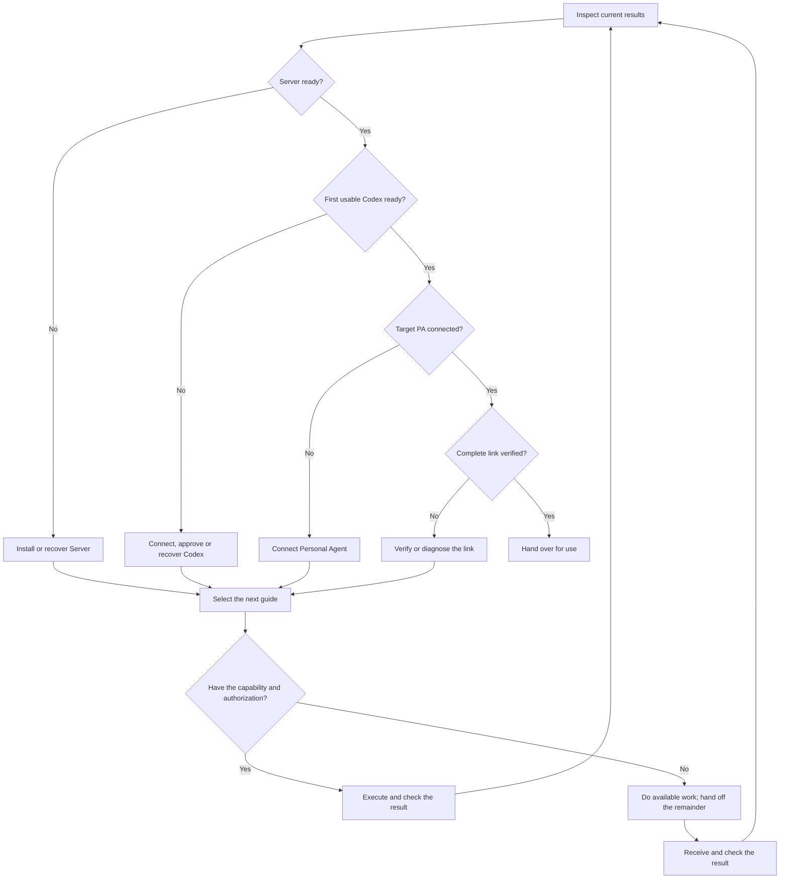

# Continue or hand off

Use when a stage finishes or needs another executor. Choose the next action from verified state, then execute it, hand it off, or leave an optional choice with the user.

## Check the capability needed now

Judge actual tools and environment, not the Agent's product name.

| Task | Required capability | If missing |
| --- | --- | --- |
| Deploy Server | Release toolchain and official Wrangler access to the target account | Request CF authorization or hand off deployment; browser automation is optional |
| Connect Codex | Access to the intended Mac's actual Codex host | Hand off to Codex on that Mac; your own cloud shell is not that host |
| Approve a device / issue a code | Verified Worker management access or authorized management browser | Hand off the action; a Wrangler-capable Agent needs no browser-login setup |
| Configure a PA | Its real plugin/MCP tools or settings | Hand off the missing configuration or consent step; the user can operate the browser |

Complete available work first. PA preparation can overlap Mac installation; both still need their own completion checks.

## Choose the next action

Fresh and resumed installations use the same decision path. Inspect unknown state before treating a component as missing. For one specific task, enter at “Select the next guide” and stop when that task is verified.



Use the table below for the corresponding guide and cases where the nominal installation order cannot yet be verified from this environment. If blocked, continue independent authorized work instead of repeating the same check.

| Verified state | Continue |
| --- | --- |
| Server ready, no Codex | [Connect Codex](../codex/connect.md), locally or by handoff |
| Device awaiting approval | [Approve that application](../codex/approve.md) |
| Codex ready, PA not connected | [Connect dot](../personal-agents/dot/index.md) or [Cue](../personal-agents/cue/index.md) |
| User reports the Mac was connected elsewhere | Inspect management `devices` or remote `list_connections`. If needed, connect the current PA first, then query |
| MCP works, no usable Codex | [Resolve the device state](../troubleshooting/device.md) |
| PA sees usable Codex | For full installation, verify the complete link below; for a single-stage request, report that stage |
| Component updated, link unavailable | [Coordinate remaining updates](../maintenance/update.md) or diagnose the actual error |

Use fresh results instead of waiting for an obsolete local-access task. If blocked, state the last verified step and remaining action; continue independent authorized work.

## Verify the complete link

For full installation, including resumed installations:

1. In the actual PA, call `list_connections`; verify the intended Server and approved, online, compatible device/interface.
2. Use [native discovery](../usage/connections.md) to inspect a read-only capability/status method with `describe_methods`, then `call` it on that device/current runtime. Read the native result; reuse an equivalent recent successful call when available.
3. Report the verified PA → Server → Codex path. On failure, preserve completed stages and [diagnose that failure](../troubleshooting/index.md).

OAuth and device discovery alone are not full native verification. This check does not create conversations, send synthetic tasks, change settings or require unrelated conversation content. Actual work remains the user's choice.

## Hand off a task

Give one copyable message, substituting real values and versioned links. The user forwards it; the receiving Agent resolves commands and local paths.

**To Codex on the target Mac:**

```text
Connect this Mac's Codex to my existing DotX Server using this guide.
Server: HTTPS_ORIGIN
Guide: VERSIONED_CODEX_CONNECTION_GUIDE_URL
```

**To the Personal Agent being added:**

```text
Connect yourself to my existing DotX Server using this guide, then verify the usable Codex connection.
Server: HTTPS_ORIGIN
Guide: VERSIONED_CLIENT_GUIDE_URL
```

**To a management Agent:**

```text
Perform ACTION for TARGET on this existing DotX Server, verify the result, and report what can continue.
Server: HTTPS_ORIGIN
Guide: VERSIONED_TASK_GUIDE_URL
```

Include known application/device/PA row IDs. For resumption, add one sentence with completed work and the blocker. Keep credentials, codes and conversation bodies out of general handoffs; [deliver a code only to its enrollment flow](../personal-agents/access-code.md#deliver-and-return).

## Close the requested installation

Use actual names and URLs in a short completion message:

- **Ready:** which PA reaches which Codex, checks passed, and any remaining verification. Do not claim full delivery from discovery alone.
- **Use:** suggest one relevant request, such as “On Mac mini, read the progress of the Codex task I choose.” Do not send it unasked.
- **Expand:** offer the handoffs above for another PA or Mac using this Server; do not start extra installations unasked.
- **Manage:** give `/admin` and the configured password/passkey method, or state setup was deferred. Offer [browser setup](../server/browser-login.md) when wanted; it enables management without Wrangler.

Lead with any incomplete action. Installation, approval, current conversation tool loading and actual remote use are separate results.
