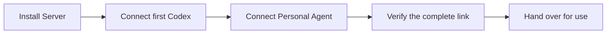

# DotX agent guide

Choose your starting point; read only the guide needed for the next action.

## Installation and continuation

Recommended path for a complete new network:

- **Fresh installation:** start with Server and continue through delivery. Verify each stage before reporting it complete.
- **Resume installation:** inspect existing results and continue the first unfinished stage. Unknown does not mean missing; preserve completed work and identities.
- **One specific task:** use the table below and complete that scope without restarting the whole installation.

Use the [state and capability decision diagram](common/handoff.md#choose-the-next-action) to choose what to do here and what to hand off. Missing Mac access does not prevent Server deployment. Preparations can overlap; full delivery still requires all stages and [end-to-end verification](common/handoff.md#verify-the-complete-link).

## Choose a task

| User's goal | Guide | MCP goal |
| --- | --- | --- |
| Install a Server | [Install Server](server/install.md) | `server_install` |
| Connect this Mac's Codex | [Connect Codex](codex/connect.md) | `codex_connect` |
| Connect dot | [Connect dot](personal-agents/dot/index.md) | `dot` |
| Connect Cue | [Connect Cue](personal-agents/cue/index.md) | `cue` |
| Use an existing network | [Find a Codex](usage/connections.md) | `connections` |
| Update components | [Coordinate an update](maintenance/update.md) | `update` |
| Uninstall, reset or change Server | [Remove or reset](maintenance/remove.md) | `remove` |
| Resolve a failure | [Choose the observed problem](troubleshooting/index.md) | `troubleshooting` |
| Verify, continue or hand off | [Completion and handoff](common/handoff.md) | `handoff` |

## Read a guide

- **MCP:** call `get_instructions` with its goal. Omit the goal for the complete path-to-goal catalog; linked subtasks are readable through MCP without a browser.
- **Desktop:** follow bundled relative links; `device_status.docs_dir` identifies the guides.
- **GitHub/release files:** follow links within the selected version. Use installed-version guides for current behavior and target-version guides for updates.

Reuse guidance already read. Complete linked subtasks, then return to the step that requested them. If blocked, report the last verified result and the exact remaining action.
